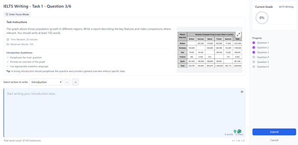
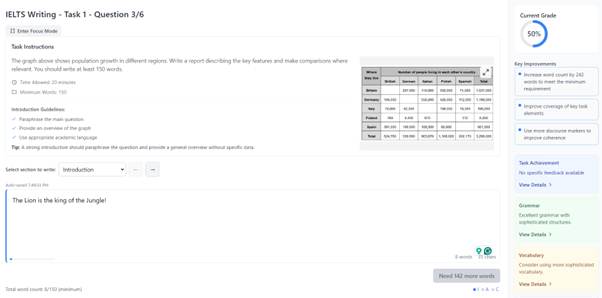
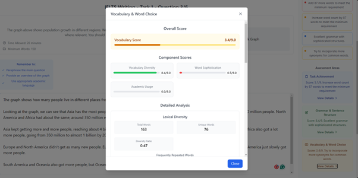
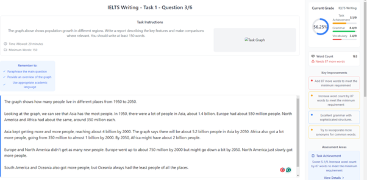
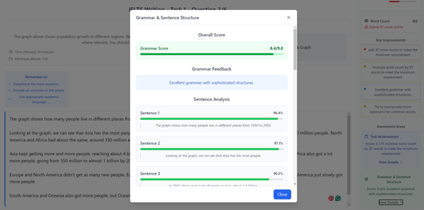

# English Ready: IELTS Writing Revision Platform with Automated Essay Scoring

**arXiv 2025**  
**IELTS Writing Revision Platform with Automated Essay Scoring and Adaptive Feedback**

[Paper](https://doi.org/10.48550/arXiv.2512.24460) | Modal Code (TBA) 

**Titas Ramancauskas, Kotryna Ramancauske**  
_Computation and Language (cs.CL); Human-Computer Interaction (cs.HC)_

---

## Overview

English Ready is an intelligent IELTS writing revision platform designed to assist candidates preparing for the **IELTS Academic Writing exam**.  
The system provides **automated essay scoring (AES)** and **adaptive, rubric-aligned feedback** tailored to official IELTS Writing Band Descriptors.

Traditional IELTS preparation tools offer limited personalised feedback and often fail to align closely with examiner marking criteria. English Ready addresses these limitations by combining a **dedicated writing interface**, **machine learning–based scoring**, and **adaptive feedback strategies** developed through iterative **Design-Based Research (DBR)** cycles.

---

## Key Features

### AI-Powered Writing Analysis
Real-time feedback on IELTS writing tasks using machine learning models that evaluate:

- Task Achievement
- Coherence and Cohesion
- Lexical Resource
- Grammatical Range and Accuracy
- Focus Mode (low-distraction writing)

<div align="center">
  
  <p><em>Isolated low-stress writing environment designed to simulate exam conditions</em></p>
</div>

---

### Automated Feedback & Scoring

<div align="center">
  
  <p><em>Automated band score prediction with targeted feedback aligned to IELTS criteria</em></p>
</div>

<div align="center">
  
  <p><em>Lexical resource analysis with component-level vocabulary assessment</em></p>
</div>

---

### Writing Interface & Analysis Tools

<div align="center">
  
  <p><em>Dedicated writing interface with dashboard-based feedback presentation</em></p>
</div>

<div align="center">
  
  <p><em>Sentence-level grammar analysis with detailed error explanations</em></p>
</div>

---

## System Design

The platform separates **conversational guidance** from a **focused writing interface** to reduce cognitive load during revision.  
Automated scoring is performed using a **DistilBERT transformer model with a regression head**, enabling direct prediction of IELTS band scores.

Adaptive feedback strategies are applied based on observed revision behaviour, with conservative surface-level interventions shown to be more reliable than aggressive structural changes.

---

## Results Summary

- Rule-based scoring approaches suffered from:
  - Mid-band compression
  - Low accuracy
  - Negative score predictions
- Transformer-based AES model achieved:
  - **MAE = 0.66**
- Adaptive feedback produced statistically significant improvements:
  - Mean band increase: **+0.060**
  - *p* = 0.011
  - Cohen’s *d* = 0.504

Results suggest automated feedback is most effective as a **supplement to human instruction**, particularly in IELTS preparation contexts.

---

## Technology Stack

- **Backend:** C# MVC (.NET 6)
- **Chatbot:** Microsoft Bot Framework
- **ML Models:** Python (DistilBERT-based AES)
- **Frontend:** React (gamified UI)
- **Integration:** REST APIs
- **Deployment:** Azure Bot Service

---

## Requirements

- .NET 6.0+
- Microsoft Bot Framework SDK
- Python 3.8+
- Node.js
- Azure Bot Service (for deployment)

---

## Limitations & Future Work

- Reduced reliability for high-band (Band 8–9) essays
- Limited evaluation with real IELTS candidates
- No examiner-validated benchmark scores

Future work will explore longitudinal studies, examiner validation, and improved modeling of discourse-level writing features.

---

## Citation

If you use this work, please cite:

```bibtex
@misc{ramancauskas2025englishready,
  title={IELTS Writing Revision Platform with Automated Essay Scoring and Adaptive Feedback},
  author={Ramancauskas, Titas and Ramancauske, Kotryna},
  year={2025},
  eprint={2512.24460},
  archivePrefix={arXiv},
  primaryClass={cs.CL}
}
